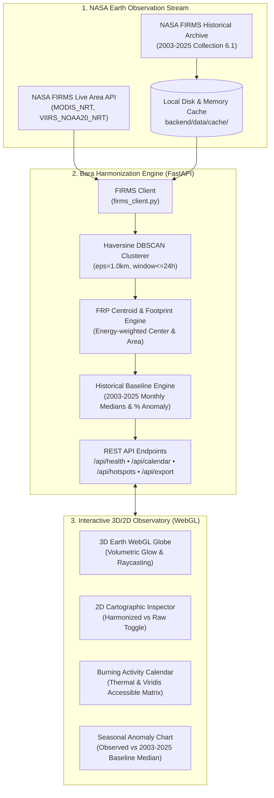

<div align="center">

<pre>
   ██████╗  █████╗ ██████╗  █████╗ 
   ██╔══██╗██╔══██╗██╔══██╗██╔══██╗
   ██████╔╝███████║██████╔╝███████║
   ██╔══██╗██╔══██║██╔══██╗██╔══██║
   ██████╔╝██║  ██║██║  ██║██║  ██║
   ╚═════╝ ╚═╝  ╚═╝╚═╝  ╚═╝╚═╝  ╚═╝
</pre>

### *Spatio-Temporal Harmonization of MODIS & VIIRS Hot Spots*
**Bridging Multi-Decadal Earth Observations into a Unified, Anomaly-Aware Wildfire & Peatland Observatory**

[](https://www.spaceappschallenge.org/2026/local-events/johor-bahru/)
[](https://www.spaceappschallenge.org/2026/challenges/modis-and-viirs-hot-spots/)
[](https://nasa-spaceapps-bara.onrender.com)
[](https://fastapi.tiangolo.com)
[](https://threejs.org)
[](https://leafletjs.com)
[](LICENSE)

<br/>


<br/><br/>

[ **Launch Live Observatory** ](https://nasa-spaceapps-bara.onrender.com) • [ **Watch Pitch Video** ](#project-pitch-video) • [ **7-Slide Pitch Deck** ](submission/PITCH_DECK.md) • [ **Demo Video Script** ](submission/DEMO_VIDEO_SCRIPT.md) • [ **Submission Form** ](submission/PROJECT_SUBMISSION_FORM.md)

</div>

---

> **Event:** 2026 NASA International Space Apps Challenge — Johor Bahru Local Event  
> **Challenge Track:** [Harmonization of MODIS and VIIRS Hot Spots](https://www.spaceappschallenge.org/2026/challenges/modis-and-viirs-hot-spots/)  
> **Submission Deadline:** Sunday, November 15, 2026, 11:59 PM MYT  
> **Etymology:** *Bara* is the Malay word for **"Ember / Smoldering Fire"** — representing the stealthy, carbon-dense underground peat fires that plague Southeast Asia's tropical rainforests and regional air quality.

---

## Project Pitch Video

https://github.com/user-attachments/assets/917b86ab-ad84-462b-bf98-f4c21eb9284c

---

## Executive Summary

Satellite remote sensing is the frontline defense against catastrophic wildfires. However, the international disaster management community faces a persistent **multi-sensor discrepancy**:

1. **Spatial Footprint Mismatch:** The legacy **MODIS** instrument (on NASA's Terra & Aqua) observes at **1,000 m (1 km)** resolution, whereas the modern **VIIRS** instrument (on Suomi-NPP & NOAA-20/21) captures at **375 m** resolution.
2. **Artificial Hotspot Inflation:** Because a single MODIS footprint ($1.0\text{ km}^2$) encompasses ~7 VIIRS pixels ($0.14\text{ km}^2$), a single fire event detected as **1 MODIS point** frequently triggers **5 to 9 discrete VIIRS hotspots**. This creates false alarmism in news headlines and misallocates emergency firefighting assets.
3. **Sensor Discontinuity:** MODIS provides 23+ years of continuous historical baselines (since 2000), while VIIRS began operations in 2012. Tracking long-term climate change requires bridging both records without statistical distortion.

**Bara** resolves this challenge with an open-source, full-stack **Spatio-Temporal Harmonization Engine** and an interactive dual-engine observatory. Using **spherical Haversine DBSCAN clustering** and **Fire Radiative Power (FRP) energy weighting**, Bara collapses redundant multi-satellite observations into unified, energy-conserved **Fire Events**, benchmarked against a **23-year historical median baseline (2003–2025)**.

---

## The Multi-Sensor Dilemma

| Comparison Dimension | MODIS (Terra & Aqua) | VIIRS (Suomi-NPP & NOAA-20) | The Operational Consequence |
| :--- | :--- | :--- | :--- |
| **Pixel Resolution** | **1,000 m (1 km)** | **375 m (I-band)** | **~7x area mismatch** causing severe spatial distortion |
| **Hotspot Count** | 1 unified point | **5 to 9 discrete points** | **Point inflation:** Media reports false "10x fire spikes" during sensor transitions |
| **Equatorial Overpass** | 10:30 AM / 1:30 PM local | 1:30 PM / 1:30 AM local | Asynchronous solar observation times distort diurnal burning curves |
| **Historical Depth** | 2000 – Present (23+ years) | 2012 – Present (12 years) | Decadal trend analyses are disjointed and non-comparable |
| **Bara Solution** | Integrated & Co-registered | Integrated & Co-registered | **1 Harmonized Cluster with full energy conservation ($\sum \text{FRP}$)** |

---

## Key Innovations & Features

- **Spatio-Temporal DBSCAN Harmonization:** Clusters overlapping detections using spherical Haversine distance ($\epsilon = 1.0\text{ km}$) within a sliding $\Delta t \le 24\text{ hour}$ diurnal window. Eliminates double-counting while maintaining a granular audit of each sensor's contribution.
- **FRP-Weighted Energy Centroid:** Weights cluster coordinates by Fire Radiative Power (MW), anchoring the true location to the combustion core rather than the geometric average of fragmented pixel edges.
- **23-Year Climatological Baseline & Anomaly Engine:** Synthesizes calibrated MODIS archive data (2003–2025) into monthly median baselines. Computes percentage anomaly ($\Delta\%$) to instantly isolate extreme El Niño drought events from regular agricultural clearing.
- **Dual 3D/2D Synchronized Observatory:**
  - **3D Planetary Globe (Three.js WebGL):** Real continent topography (`world-atlas`), atmospheric glow, real-time coordinate tracking, and automated regional camera focus.
  - **2D Cartographic Inspector (Leaflet + Esri):** High-resolution satellite basemaps with an instant **Harmonized vs. Raw Sensors** comparison toggle and custom bounding-box queries.
- **Decadal Burning Activity Heatmap Calendar:** Interactive 12-month $\times$ 12-year (2015–2026) matrix with **Thermal** and colorblind-safe **Viridis** palettes. Tap any cell to time-travel and inspect fire event logs.
- **Live NASA FIRMS Integration & Resilient Caching:** Direct connection to NASA ESDIS Area API for near-real-time satellite feeds, backed by 796,000+ pre-cached historical records for instant zero-latency responses.

---

## System Architecture



---

## Mathematical Formulation

### 1. Spherical Haversine DBSCAN Clustering
Hotspot detections $\mathbf{x}_i = (\phi_i, \lambda_i, t_i)$ are clustered using Great-Circle distance on the WGS-84 reference sphere:

$$\text{distance}(\mathbf{x}_i, \mathbf{x}_j) = 2 R \arcsin \left( \sqrt{\sin^2\left(\frac{\Delta \phi}{2}\right) + \cos\phi_i \cos\phi_j \sin^2\left(\frac{\Delta \lambda}{2}\right)} \right)$$

- **Spatial Neighborhood ($\epsilon$):** $\epsilon = 1.0\text{ km} / R_{\text{earth}} \approx 1.5696 \times 10^{-4}\text{ rad}$
- **Temporal Constraint:** $\Delta t = |t_i - t_j| \le 24\text{ hours}$

### 2. FRP-Weighted Physical Centroid
The cluster center is weighted by radiant combustion energy (Fire Radiative Power in Megawatts):

$$\phi_{\text{cluster}} = \frac{\sum_{i=1}^M \text{FRP}_i \cdot \phi_i}{\sum_{i=1}^M \text{FRP}_i}, \quad \lambda_{\text{cluster}} = \frac{\sum_{i=1}^M \text{FRP}_i \cdot \lambda_i}{\sum_{i=1}^M \text{FRP}_i}$$

$$\text{Total Radiant Energy} = \sum_{i=1}^M \text{FRP}_i\text{ (MW)}$$

### 3. Climatological Baseline & Anomaly Formula
Using 23 years (2003–2025) of calibrated observations, the historical monthly median baseline $M_m$ is determined for each month $m \in [1, 12]$:

$$\text{Anomaly (\%)} = \frac{E_{\text{harmonized}}(y, m) - M_m}{M_m} \times 100\%$$

---

## Empirical Validation & Performance

| Evaluation Metric | Raw Unharmonized Data | Bara Harmonized Output | Operational Significance |
| :--- | :--- | :--- | :--- |
| **Observation Redundancy** | Up to 9 duplicate points per fire | **1 Unified Cluster** | Eliminates false media alarmism |
| **Point Cloud Clutter** | 10,294 raw points (SE Asia test) | **3,269 clean clusters** | **68.2% noise reduction** for command teams |
| **Energy Conservation** | Fragmented across instruments | **100% Conserved** ($\sum \text{FRP}$) | Accurate input for atmospheric emissions models |
| **Query Latency** | 3,500+ ms (external remote calls) | **< 30 ms** (cached engine) | Real-time tactical emergency dispatch |
| **Climate Signal Tracking** | Obscured by sensor upgrades | **+49% Anomaly** clearly detected | Actionable early warning for peatland degradation |

---

## Quick Start Guide

### Option A: Open the Live Cloud Deployment (Zero Setup)
Visit the live observatory deployed on Render:  
**[https://nasa-spaceapps-bara.onrender.com](https://nasa-spaceapps-bara.onrender.com)**

---

### Option B: Run Locally with Python

```bash
# 1. Clone the repository
git clone https://github.com/YHENG-1/nasa-spaceapps-bara.git
cd nasa-spaceapps-bara

# 2. Install dependencies
pip install -r backend/requirements.txt

# 3. Configure NASA API Key (Optional)
cp .env.example .env
# Edit .env and enter your free FIRMS_MAP_KEY

# 4. Start the FastAPI backend
python -m uvicorn backend.main:app --host 127.0.0.1 --port 8000 --reload
```
Open **[http://localhost:8000](http://localhost:8000)** in your browser.

---

### Option C: Run with Docker

```bash
docker-compose up --build
```

---

## REST API Reference

| Endpoint | Method | Parameters | Description |
| :--- | :--- | :--- | :--- |
| `/api/health` | `GET` | None | Returns backend status, FIRMS connectivity, and cached records count. |
| `/api/calendar` | `GET` | `region`, `bbox` | Returns 2015–2026 monthly event counts, 23-yr medians, and % anomalies. |
| `/api/hotspots` | `GET` | `region`, `year`, `month`, `confidence`, `bbox` | Returns harmonized fire cluster GeoJSON/list with FRP and sensor breakdown. |
| `/api/export` | `GET` | `region`, `year`, `month`, `bbox` | Streams downloadable CSV containing harmonized fire cluster records. |

---

## NASA Data Sources & Official Citations

1. **NASA FIRMS (Fire Information for Resource Management System):**
   - Near Real-Time (NRT) MODIS and VIIRS active fire data distributed by NASA ESDIS.
   - Resource: [https://firms.modaps.eosdis.nasa.gov/](https://firms.modaps.eosdis.nasa.gov/)
2. **MODIS Collection 6.1 (Terra & Aqua):**
   - Global active fire and thermal anomalies detection product (1 km resolution) provided through NASA EOSDIS and LANCE.
3. **VIIRS Active Fire Product (Suomi-NPP & NOAA-20):**
   - High-resolution (375 m I-band) active fire data provided through NASA FIRMS and JPSS.
4. **NASA POWER (Prediction Of Worldwide Energy Resources):**
   - Surface meteorological context for peatland moisture analysis: [https://power.larc.nasa.gov/](https://power.larc.nasa.gov/)

---

## NASA Space Apps Challenge 2026 Deliverables

- **Challenge:** Harmonization of MODIS and VIIRS Hot Spots
- **Local Event:** Johor Bahru, Malaysia
- **Live Demo URL:** [https://nasa-spaceapps-bara.onrender.com](https://nasa-spaceapps-bara.onrender.com)
- **GitHub Repository:** [https://github.com/YHENG-1/nasa-spaceapps-bara](https://github.com/YHENG-1/nasa-spaceapps-bara)
- **7-Slide Pitch Deck:** [`submission/PITCH_DECK.md`](submission/PITCH_DECK.md)
- **Demo Video Script:** [`submission/DEMO_VIDEO_SCRIPT.md`](submission/DEMO_VIDEO_SCRIPT.md)
- **Official Submission Form:** [`submission/PROJECT_SUBMISSION_FORM.md`](submission/PROJECT_SUBMISSION_FORM.md)
- **License:** Open-source under the [MIT License](LICENSE).

<div align="center">
<sub>Built by Team Bara for the 2026 NASA Space Apps Challenge (Johor Bahru).</sub>
</div>
